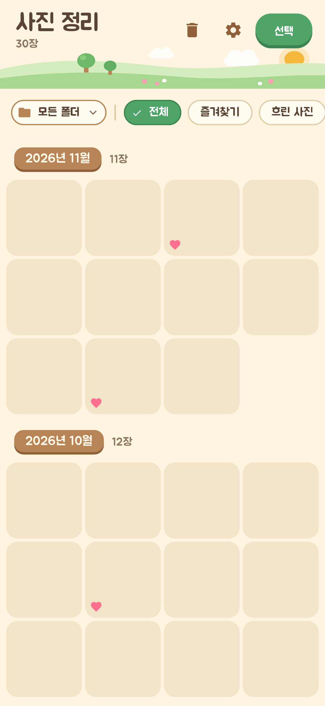
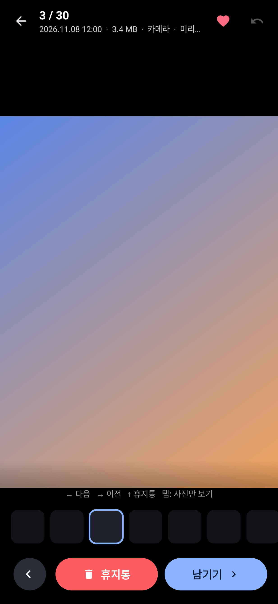
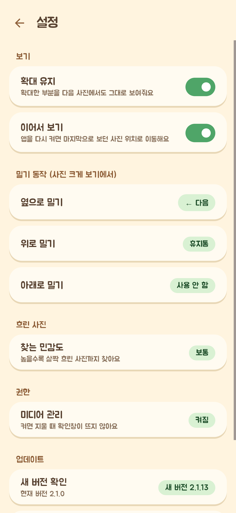

# 사진 정리 (PhotoClean)

갤러리 사진을 한 장씩 보면서 **버튼 한 번으로 바로 휴지통**으로 보내는 안드로이드 앱입니다. (갤럭시 포함 Android 11 이상)

| 전체 보기 | 한 장 보기 | 설정 |
|---|---|---|
|  |  |  |

## 전체 보기
- **월별로 묶어서** 보여줌 (2026년 11월 · 11장 …)
- 오른쪽 끝을 잡고 끌면 **빠른 스크롤** + 날짜 말풍선
- **두 손가락 벌리기/오므리기** → 칸 크기 조절 (한 줄 2~8장)
- 위쪽 칩: **📁 폴더 고르기**(카메라·스크린샷·카카오톡 등) / **전체 · 즐겨찾기 · 흐린 사진**
- **선택**(또는 길게 누르기) → 여러 장 골라 **한 번에 휴지통**
- **이어서 보기**: 앱을 다시 켜면 마지막으로 보던 사진 위치로 이동, 버튼으로 바로 열기

## 한 장 보기
- **휴지통** / **남기기 ▶** / ◀ 버튼, 아래 **썸네일 줄**에서 탭하면 그 사진으로 이동
- 밀기: 기본 ← 다음 · → 이전 · ↑ 휴지통 (설정에서 바꿀 수 있음)
- **두 손가락 확대/축소**, **더블탭** 확대·원래대로 — **확대 유지**가 켜져 있으면 다음 사진도 같은 부분이 확대됨
- 사진을 **한 번 탭**하면 위/아래 막대를 숨기고 사진만 보기
- ♡ 즐겨찾기, ↶ 되돌리기

## 흐린 사진 찾기
- **흐린 사진** 칩을 누르면 폰 안에서 사진 선명도를 계산해 흐린 사진만, **가장 흐린 것부터** 보여줌 (인터넷 사용 안 함)
- 처음 한 번만 계산하고 결과를 저장해 두므로 다음부터는 바로 나옴
- 설정에서 민감도(낮음/보통/높음) 조절. 자동 판단이라 틀릴 수 있으니 지우기 전에 꼭 확인하세요

## 설정 (⚙)
- 확대 유지 (기본 켜짐) · 이어서 보기 (기본 켜짐)
- 옆으로 밀기 방향 / 위로 밀기 / 아래로 밀기 동작 (휴지통 · 즐겨찾기 · 전체 보기로 · 사용 안 함)
- 흐린 사진 민감도 · 미디어 관리 권한 상태

## 휴지통
전체 보기 위쪽 🗑 → 최근에 지운 순서, 사진마다 자동 영구 삭제까지 남은 날 표시, 골라서 **복원** 또는 **영구 삭제**.
안드로이드 기본 휴지통을 사용하며 30일 뒤 자동 삭제됩니다.

## 즐겨찾기
안드로이드 표준 즐겨찾기 값을 사용합니다. 삼성 갤러리에서 누른 하트가 보이는지는 One UI 버전에 따라 다를 수 있어요.

## 확인창 없이 바로 삭제하기
'미디어 관리' 권한을 켜면 휴지통으로 보낼 때 확인창이 뜨지 않습니다. (Android 12 이상, 앱 안내 또는 설정에서 켜기)

## 설치 / 업데이트
- 처음 설치: GitHub **Releases**에서 최신 `PhotoClean-x.y.z.apk` 받아서 열기 → "출처를 알 수 없는 앱 설치" 허용 → 설치
- 그다음부터는 앱 **설정 > 업데이트 > 새 버전 확인**에서 바로 받아서 설치 (자동 확인을 켜두면 앱 켤 때 알려줌)
- 코드를 올릴 때마다 GitHub Actions가 버전을 올려(2.1.N) 릴리즈를 자동으로 만듭니다
- 모든 빌드는 `app/signing/photoclean.keystore`로 서명합니다 (같은 키여야 덮어서 업데이트 가능).
  공개 저장소라 이 키는 누구나 볼 수 있으니, 이 저장소 Releases가 아닌 곳에서 받은 APK는 설치하지 마세요

## 개발
```
./gradlew testDebugUnitTest assembleDebug
# 화면 스크린샷 저장
./gradlew testDebugUnitTest --tests '*ScreenshotTest' -Pscreenshots.dir=/some/dir
```
